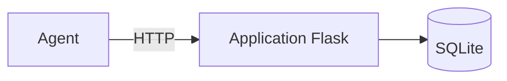

# TP2-A — Modéliser les menaces de l'application

**Jour 1, 13:50 · 50 min · par équipe, animé par le champion sécurité.** Objectif : répondre, avant de
toucher au code, à la question « qu'est-ce qui peut mal tourner ? ». Support : section 2.7. Modèle :
`docs/modeles/02-modele-de-menaces.md` de votre projet.

**Préparation.** Dans GitLab, ouvrez `docs/modeles/02-modele-de-menaces.md`, copiez son contenu, puis créez
le fichier `docs/modele-de-menaces.md` (bouton **+**, **Nouveau fichier**) et collez-y le modèle. Vous le
remplissez au fil du TP. Vous pouvez lire le code de l'application (`app.py`, `config.py`, `templates/`).

La méthode suit les **4 questions d'Adam Shostack** ; ce TP traite les deux premières.

## Étape 1 — Sur quoi travaillons-nous ? Le schéma des flux (10 min)

**Pourquoi.** On ne protège bien que ce qu'on a dessiné. Le schéma montre où les données entrent, où elles
sont stockées, et surtout les **frontières de confiance** : les endroits où une donnée venue de l'extérieur
entre dans votre système.

Dessinez :

- les **acteurs** : agent, gestionnaire, attaquant ;
- les **processus** : l'application Flask, ses pages (connexion, liste, recherche, détail, création, clôture) ;
- les **stockages** : la base SQLite (tables `users` et `demandes`), les journaux, le dépôt Git ;
- les **flux** entre eux, et les **frontières de confiance** (navigateur / application, application / base).

Vous pouvez dessiner sur papier et prendre une photo, ou écrire le schéma en Mermaid dans le fichier :
GitLab l'affiche comme un diagramme.

````markdown

````

## Étape 2 — Les biens sensibles (10 min)

Listez ce qui aurait de la valeur pour un attaquant ou dont la fuite nuirait aux agents : données, comptes,
secrets, journaux, code.

## Étape 3 — Qu'est-ce qui peut mal tourner ? STRIDE (20 min)

**Pourquoi.** STRIDE est une grille de six familles de menaces. L'appliquer élément par élément évite
d'oublier une famille entière.

| Lettre | Menace | Question à poser |
| --- | --- | --- |
| S | Usurpation d'identité | Quelqu'un peut-il se faire passer pour un autre ? |
| T | Altération | Peut-on modifier une donnée ou une requête ? |
| R | Répudiation | Peut-on nier avoir agi, faute de trace ? |
| I | Divulgation | Une donnée peut-elle fuiter ? |
| D | Déni de service | Peut-on rendre le service indisponible ? |
| E | Élévation de privilèges | Peut-on faire ce que son rôle n'autorise pas ? |

Pour chaque menace trouvée, une ligne dans le tableau du modèle, avec :

- une **vraisemblance** de 1 à 4 et un **impact** de 1 à 4 ;
- le **score** = vraisemblance × impact.

Gardez les **5 menaces au score le plus élevé**, numérotées M-01 à M-05.

## Étape 4 — Présentation croisée (10 min)

Chaque équipe présente son schéma et ses 5 menaces en 3 minutes. L'autre équipe signale une menace qui
manque.

## Point de contrôle

- Un schéma des flux avec ses frontières de confiance.
- Cinq menaces M-01 à M-05 cotées, **dont l'accès aux demandes d'un autre agent**.

Échelle commune des scores (elle resservira au TP4-B) :

| Score | Niveau | Délai de traitement indicatif |
| --- | --- | --- |
| 12 à 16 | Critique | Avant toute mise en production |
| 8 à 11 | Élevé | Sprint en cours |
| 4 à 7 | Moyen | Version en cours |
| 1 à 3 | Faible | Backlog, ou acceptation signée |

---

[Corrigé](corrige/README.md) · [Sommaire](../README.md) · TP suivant : [TP2-B](../tp2b/README.md)
