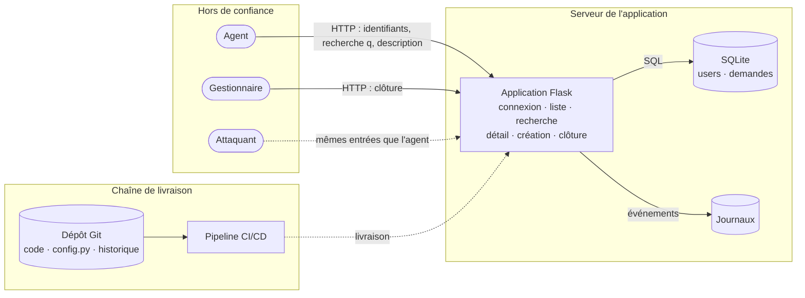

# Corrigé du TP2-A

## Le schéma des flux

**Deux frontières de confiance** comptent le plus : entre le navigateur et l'application (toute saisie est
hostile tant qu'elle n'est pas validée) et entre le dépôt et l'application (ce qui est dans le code et
l'historique finit en production).

## Les biens sensibles

- Les **demandes** et leur contenu, dont un **RIB** (demande 4 de bob).
- Les **comptes** et les **empreintes de mots de passe** (table `users`).
- La **session** du gestionnaire, qui peut clôturer toutes les demandes.
- Les **secrets** de l'application : `SECRET_KEY`, jeton d'API de notification dans `config.py`.
- Les **journaux** : ils ne devraient contenir aucun secret.

## Les menaces attendues

| ID | Élément | STRIDE | Menace | V | I | Score |
| --- | --- | --- | --- | --- | --- | --- |
| M-01 | Consultation d'une demande | E, I | Un agent lit la demande d'un autre en changeant le numéro dans l'URL | 4 | 3 | 12 |
| M-02 | Recherche | T, I | Injection SQL qui extrait les comptes et leurs empreintes | 3 | 4 | 12 |
| M-03 | Clôture | E | Un agent clôture une demande qui n'est pas la sienne | 4 | 2 | 8 |
| M-04 | Description | T, E | XSS stockée exécutée dans la session du gestionnaire | 3 | 3 | 9 |
| M-05 | Base, table `users` | I | Empreintes MD5 retrouvées par dictionnaire | 2 | 4 | 8 |
| M-06 | Code source, dépôt | I | Jeton d'API lisible dans le code et l'historique Git | 3 | 3 | 9 |
| M-07 | Journaux | I, R | Mots de passe écrits dans les journaux ; actions sensibles non tracées | 3 | 3 | 9 |
| M-08 | Connexion | S, D | Essais de mots de passe sans limite | 3 | 3 | 9 |

Vos cotes peuvent différer d'un point : ce qui compte, c'est que l'équipe sache justifier chacune. Vos
5 premières doivent contenir **M-01 et M-02** (score 12, critique).

## À retenir

- **M-01 et M-03 ne seront trouvées par aucun scanner** au TP3-B : ce sont des règles métier (« un agent ne
  voit que ses demandes »). Seules la conception et les tests issus des stories les attrapent. Si vous les
  avez manquées, repensez à la démonstration de ce matin.
- **Six menaces sur huit** sont sur l'entrée de l'application ou sur sa chaîne de livraison : c'est là
  qu'il faut regarder en premier.

---

[Énoncé](../README.md) · [Sommaire](../../README.md)
